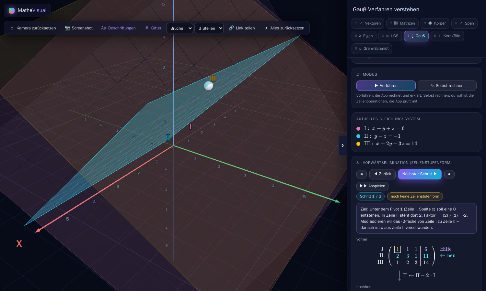
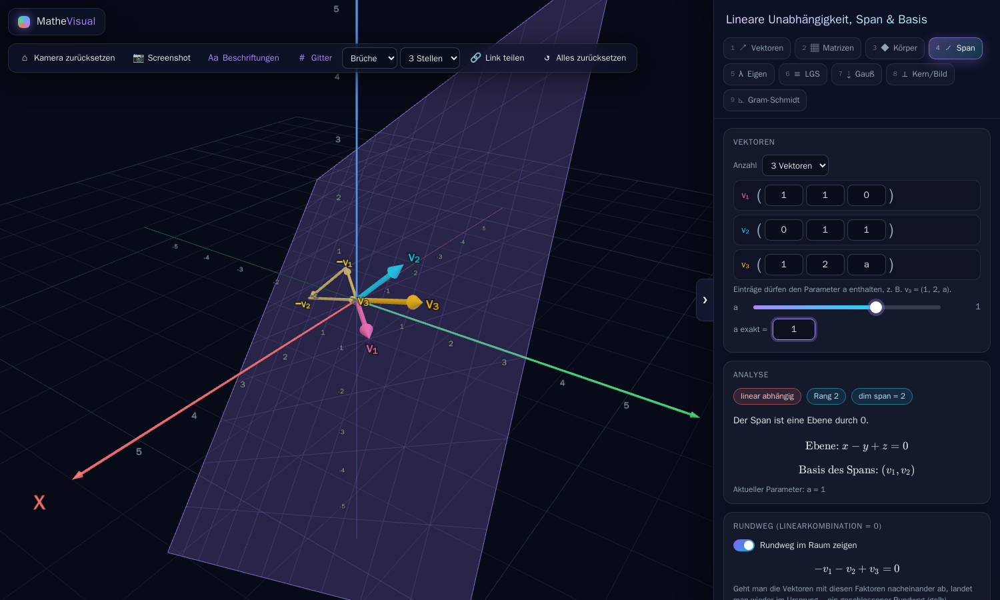
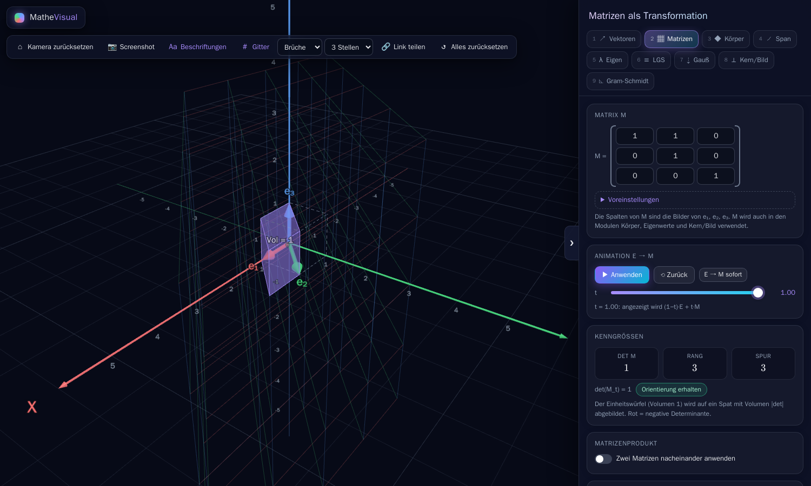

# MatheVisual – Lineare Algebra 1 in 3D

Lokal laufende Webapp zur Visualisierung der Linearen Algebra im dreidimensionalen Raum.
Oberfläche auf Deutsch, läuft komplett offline (keine CDN-Abhängigkeiten).



| Span & lineare Abhängigkeit | Matrix als Transformation |
|---|---|
|  |  |

## Starten

```bash
docker compose up --build
```

Danach im Browser öffnen: **http://localhost:8080**

Beenden mit `Strg+C` bzw. `docker compose down`.
Beim Docker-Build laufen automatisch alle Unit-Tests mit. Schlägt ein Test fehl, bricht der Build ab.

### Entwicklung ohne Docker (optional, Node ≥ 20)

```bash
npm install
npm run dev      # Dev-Server auf http://localhost:5173
npm test         # Vitest-Unit-Tests
npm run build    # Produktions-Build nach dist/
```

## Module

| # | Modul | Inhalt |
|---|-------|--------|
| 1 | Vektoren | beliebig viele Vektoren (Farbe, an/aus), Summe, k·a, Skalarprodukt mit Projektion und Winkel, Kreuzprodukt, Länge – jeweils mit aufklappbarem Rechenweg; Spitzen per Maus verschiebbar; Ebenen per „+ Ebene“ (Stütz-/Richtungsvektoren oder Koordinatenform) |
| 2 | Matrizen | 3×3-Matrix, Animation E → M (Slider t), verformtes Gitter, Basis e₁ e₂ e₃, Einheitswürfel (Volumen = \|det\|, rot bei gekippter Orientierung), Rang, Spur, Voreinstellungen, Matrizenprodukt N·M mit sichtbarer Reihenfolge |
| 3 | Körper | Würfel, Kugel, Tetraeder, Zylinder, eigene Punktwolke, jeweils verformt, Original als Geisterbild |
| 4 | Span | Unabhängigkeit, Rang, dim Span, Darstellung als Gerade, Ebene oder Raum, „Rundweg“ (z. B. −v₁ − v₂ + v₃ = 0), Parameter a, Basiswechsel |
| 5 | Eigenwerte | charakteristisches Polynom (auch faktorisiert), Eigenräume als Geraden/Ebenen, Vielfachheiten, Diagonalisierbarkeit mit P und D |
| 6 | LGS | drei Ebenen, Lösung als Punkt, Gerade, Ebene oder leer, Gauß-Jordan Schritt für Schritt (KaTeX) |
| 7 | Gauß-Trainer | Gauß-Verfahren zum Verstehen: Beispiele mit „guten“ Zahlen, jeder Schritt begründet, Vorher/Nachher-Matrix mit Pivot und neuer Null, eintragweise Rechnung, Ebenen drehen sich im 3D um die Schnittgerade, Modus „Selbst rechnen“ mit Tipp/Rückgängig, Rückwärtseinsetzen inkl. freier Parameter |
| 8 | Kern & Bild | Nullraum und Spaltenraum mit Dimensionen (Rangsatz) |
| 9 | Gram-Schmidt | schrittweise, animierte Orthonormalisierung |

**Allgemein:** Alle Eingaben aktualisieren die Ansicht sofort. Es gibt Buttons für Kamera-Reset, Screenshot (PNG), Beschriftungen und Gitter.
Zahlen lassen sich als Brüche oder Dezimalzahlen anzeigen. Der Zustand wird automatisch im localStorage gespeichert, „Link teilen“ legt ihn zusätzlich in die URL.
Zahlenfelder lassen sich wie in Premiere **mit der Maus ziehen** (links/rechts; Shift = ×10, Alt = ÷10) oder per ↑/↓ verändern.
Eingabefelder verstehen Ausdrücke wie `1/2`, `sqrt(2)`, `cos(30 deg)`, `0,5` und im Span-Modul den Parameter `a`.
Ungültige Eingaben werden rot markiert, ohne dass die App abstürzt.

**Beispielaufgabe:** Modul *Span* mit v₁ = (1,1,0), v₂ = (0,1,1), v₃ = (1,2,a). Schiebt man den Slider auf a = 1, zeigt die App
„linear abhängig, dim span = 2“, die Ebene x − y + z = 0 und den Rundweg −v₁ − v₂ + v₃ = 0.

## Projektstruktur

```
src/
├── main.ts                 Layout, Toolbar, Tabs
├── styles.css              dunkles Glas-Design, responsiv
├── core/                   Darstellung & UI (Three.js, DOM)
│   ├── viewport.ts         Szene, Kamera, OrbitControls, Achsen, Gitter
│   ├── objects.ts          Pfeile, Labels, Ebenen, Geraden …
│   ├── transformVisuals.ts verformbares Gitter, Einheitswürfel
│   ├── components.ts       Matrix-Editor mit Voreinstellungen, Animations-Steuerung
│   ├── ui.ts               Eingabefelder, Slider, KaTeX-Helfer
│   ├── store.ts            Zustand (localStorage / Teilen-Link)
│   └── module.ts           Modul-Schnittstelle
├── math/                   reine Mathe-Logik (ohne DOM/Three.js)
│   ├── linalg.ts           Vektoren, Matrizen, rref, Kern, Eigenwerte, Gauß, Gram-Schmidt
│   ├── format.ts           Brüche/Dezimal, LaTeX-Formatierung
│   ├── parse.ts            sicheres Parsen von Eingaben (math.js)
│   └── linalg.test.ts
└── modules/<modul>/        ein Ordner pro Modul (vectors, matrix, bodies, span, eigen, lgs, gauss, kernel, gramschmidt)
    ├── math.ts             modulspezifische Logik
    ├── math.test.ts        Vitest-Unit-Tests
    └── view.ts             Panel + 3D-Darstellung
```

Tech-Stack: Vite, TypeScript, Three.js, KaTeX, math.js, Vitest, nginx:alpine (Multi-Stage-Build).

## Lizenz

Noch keine Lizenz festgelegt. Ohne Lizenz dürfen andere den Code zwar ansehen, aber nicht weiterverwenden.
Eine Lizenz (z. B. MIT) lässt sich auf GitHub über *Add file → Create new file → `LICENSE` → Choose a license template* hinzufügen.
